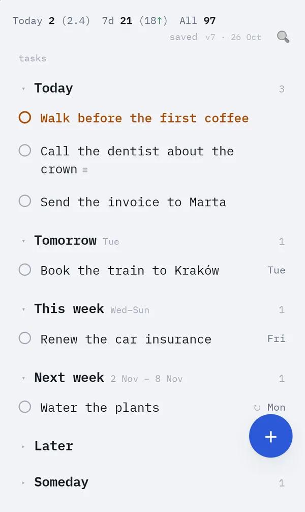

# Omark

Small tools that keep your work in plain files you own.

Omark is a set of open source apps for people and their AI agents. **Omark Tasks** keeps your tasks in three Markdown files in your own OneDrive or Google Drive: one calm page with today, this week and later, quick add, repeating tasks and habits. The files stay editable in Obsidian, any text editor, or by an AI agent such as Claude Code. **Omark Time** (in progress) turns calendar events titled `CODE; Category; description` into hours per project, in CSV files you own. No Omark server ever stores your data.



## Use it

- **Try the demo:** https://demo-tasks.omark.app. Sample tasks, no sign-in; edits stay in your browser.
- **Use the hosted app** (coming soon at `tasks.omark.app`): sign in with Microsoft or Google, and your files live in your OneDrive or Google Drive. The sign-in helper keeps nothing on the server ([SECURITY.md](SECURITY.md)).
- **Use a local folder** (coming soon): in desktop Chrome or Edge, pick a folder and skip the account entirely. Sync it with whatever you already use.
- **Host your own copy:** [doc/self-hosting.md](doc/self-hosting.md) has the environment variables, sign-in setup, deploys and Promote that this README used to hold.

Each app installs like any other: on the iPhone, Safari → Share → Add to Home Screen; in Chrome or Edge, the install icon in the address bar. Both work offline. On the iPhone, sign in inside the home-screen app itself: it has its own cookies, separate from Safari.

## Quick start

You need Node 22 or newer and pnpm 10.

```
git clone https://github.com/omark-app/omark.git
cd omark
pnpm i
pnpm demo
```

This opens Omark Tasks on http://localhost:5173 with sample tasks and no sign-in. [CONTRIBUTING.md](CONTRIBUTING.md) has the tests and how to send a change.

## Your files

```markdown
# Tasks
- [ ] Inbox zero by Friday ⏫
- [ ] Pay rent 🔁 every month on the 1st 📅 2026-11-01
    - transfer from savings
- [ ] Meditate 10 min 🌱 🔁 every day 📅 2026-10-27
```

- `tasks.md` holds your open tasks, `done.md` a log of everything you completed, `config.yaml` your settings. Completing a task moves it to `done.md` with its notes; nothing is lost.
- The format is compatible with the Obsidian Tasks emoji format, and documented as an open standard in [doc/format.md](doc/format.md), so any tool or agent can read and write it.
- Settings: the gear in the footer, or the `,` key. The page writes only what differs from the defaults and keeps your comments in `config.yaml`.

**With Claude Code.** The repo ships a skill, `.claude/skills/taskapp-files/`, that teaches Claude Code the formats. Inside this repo it is picked up automatically. To use it from anywhere, copy the folder to your personal skills folder: `~/.claude/skills/taskapp-files/` on macOS and Linux, `C:\Users\<you>\.claude\skills\taskapp-files\` on Windows. Then ask Claude to add, move or complete tasks in your files.

**Coming from Todoist?** A one-time import of your open tasks: `pnpm --filter todoist-import start -- --out <path> [--force]`, with your API token in `TODOIST_TOKEN`. Review the warnings it prints.

## Omark Time: query your hours

Omark Time (in progress) writes one CSV row per calendar event per day, so you can query your hours with anything that reads CSV. With [DuckDB](https://duckdb.org), from the `Omark Time` folder:

```sql
-- Hours per project and category in October, done time only
SELECT project, coalesce(mode(category), '') AS category,
       round(sum(round(hours * 3600)) / 3600, 4) AS hours
FROM read_csv('events-[0-9][0-9][0-9][0-9].csv', union_by_name = true)
WHERE known
  AND date BETWEEN DATE '2026-10-01' AND DATE '2026-10-31'
  AND "end" <= now()
GROUP BY project, lower(category)
ORDER BY project, lower(category) IS NULL, hours DESC;
```

On [the example files](doc/time/examples/events-2026.csv):

| project | category | hours |
| --- | --- | --- |
| ACME | Workshop | 8 |
| ACME | Coding | 5.3333 |
| ACME | CS | 2.3333 |
| ACME | Meetings | 1.5 |
| MYAPP | Coding | 10.5 |
| MYAPP |  | 1 |

```sql
-- The weekly trend per project
SELECT CAST(date_trunc('week', date) AS DATE) AS week, project,
       round(sum(round(hours * 3600)) / 3600, 4) AS hours
FROM read_csv('events-[0-9][0-9][0-9][0-9].csv', union_by_name = true)
WHERE known AND "end" <= now()
GROUP BY ALL
ORDER BY week, project;
```

| week | project | hours |
| --- | --- | --- |
| 2026-10-05 | ACME | 11 |
| 2026-10-05 | MYAPP | 3 |
| 2026-10-12 | ACME | 4.3333 |
| 2026-10-12 | MYAPP | 3.5 |
| 2026-10-19 | ACME | 1.8333 |
| 2026-10-19 | MYAPP | 5 |

`round(hours * 3600)` adds whole seconds, as the app does, so the hours match its summary. `date_trunc('week', …)` starts weeks on Monday; the `omark-time` skill shows how to start them on another day, and why the file pattern isn't just `events-*.csv`. The `omark-time` skill (`.claude/skills/omark-time/`) teaches Claude Code to add correctly titled events, answer questions like these and draft a client report. Copy it to your personal skills folder like the Tasks skill. The format is in [doc/format.md](doc/format.md#omark-time).

## How it's built

A Svelte 5 + TypeScript PWA in a pnpm monorepo, with the logic in pure packages that know nothing about the browser. [doc/architecture.md](doc/architecture.md) explains the packages, sync and merge, and the sign-in helper.

Omark is built mostly by AI agents, through GitHub issues and pull requests, in a small software factory that ships with the repo: every change is planned when it's large, written test-first, and reviewed. [doc/factory.md](doc/factory.md) describes it. Agents start at [AGENTS.md](AGENTS.md).

## More

| | |
|---|---|
| [PHILOSOPHY.md](PHILOSOPHY.md) | Why Omark exists and the principles every idea is weighed against |
| [CONTRIBUTING.md](CONTRIBUTING.md) | Set up, pick an issue, send a pull request; the AI policy |
| [AGENTS.md](AGENTS.md) | Instructions for AI coding agents |
| [GOVERNANCE.md](GOVERNANCE.md) | Who decides, how ideas become issues |
| [SECURITY.md](SECURITY.md) | Reporting a problem; what the sign-in helper keeps |
| [doc/format.md](doc/format.md) | The file formats |
| [doc/self-hosting.md](doc/self-hosting.md) | Run your own copy |
| [The Tasks spec](doc/tasks/spec.md), [the Omark Time spec](doc/time/spec.md) | What each app does, in detail |

## Licence

[MIT](LICENSE).
